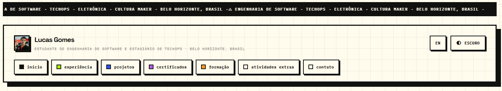
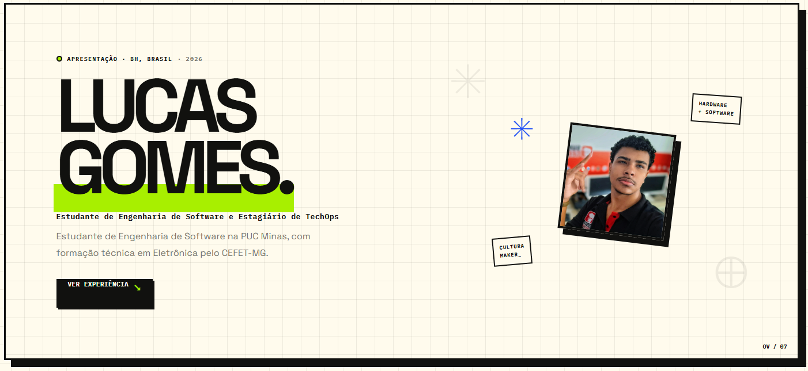
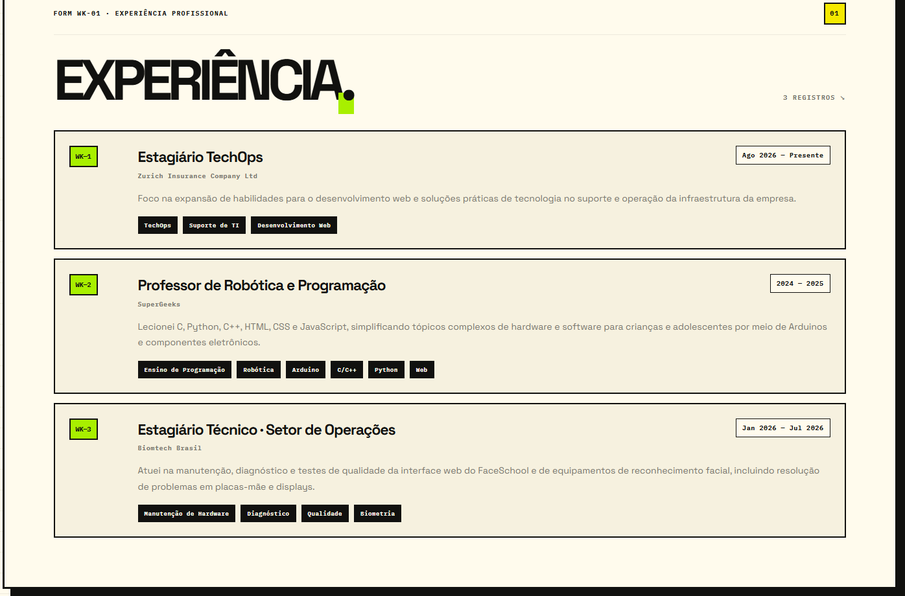
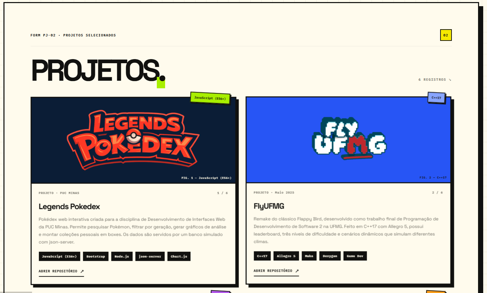
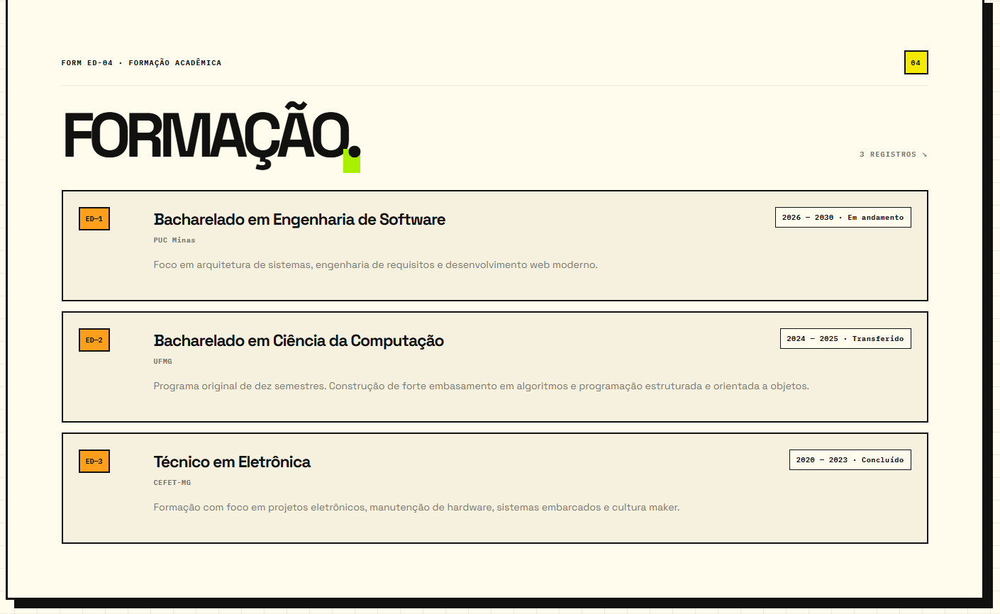

# Lucas Gomes — Portfólio

Portfólio pessoal de **Lucas Gomes**, estudante de Engenharia de Software e estagiário de TechOps. O site apresenta minha trajetória, experiência profissional, formação e projetos em uma página responsiva.

<p align="center">
  <a href="https://lukasgom3s.vercel.app"><strong>Acessar o portfólio publicado</strong></a>
</p>

[](https://angular.dev/)
[](https://www.typescriptlang.org/)
[](https://tailwindcss.com/)
[](./LICENSE)

## Visão geral

O portfólio foi desenvolvido como uma experiência de página única, com navegação entre seções, identidade visual inspirada em interfaces editoriais e suporte a temas claro e escuro. O layout se adapta a diferentes tamanhos de tela.

### Capturas de tela

#### Navegação



#### Apresentação



#### Experiência profissional



#### Projetos



#### Formação acadêmica



## Funcionalidades

- Seções de apresentação, experiência profissional, projetos, certificações, formação, atividades extracurriculares e contato.
- Cartões de projetos com links para os respectivos repositórios no GitHub.
- Alternância entre temas claro e escuro.
- Formulário de contato integrado ao EmailJS, com validação e estados de envio, sucesso e erro.
- Interface responsiva e navegação entre seções.

## Tecnologias

- **Angular 22** e **TypeScript 6** para a aplicação.
- **HTML e CSS** para estrutura, temas, animações e layout responsivo.
- **Tailwind CSS 3.4** e **PostCSS** para os estilos.
- **EmailJS Browser SDK** para o formulário de contato.
- **Node.js** e **npm** para instalação de dependências e comandos do projeto.

## Executar localmente

### Pré-requisitos

- Node.js compatível com Angular CLI 22.
- npm.

### Instalação e inicialização

Na raiz do repositório, instale as dependências e inicie o servidor de desenvolvimento:

```bash
npm ci
npm start
```

Acesse <http://localhost:4200>.

Para gerar o build de produção:

```bash
npm run build
```

Os arquivos compilados são gerados em `dist/`.

## Hospedagem

O projeto está publicado na **Vercel**: [lukasgom3s.vercel.app](https://lukasgom3s.vercel.app).

## Estrutura do projeto

```text
.
├── public/
│   └── images/
│       ├── printWebSite/        # Capturas de tela do portfólio
│       ├── profile/             # Foto de perfil
│       └── projects/            # Imagens dos projetos
├── src/
│   ├── app/
│   │   ├── config/
│   │   │   └── emailjs.config.ts # Configuração do EmailJS
│   │   ├── app.component.css
│   │   ├── app.component.html
│   │   ├── app.component.ts
│   │   ├── app.config.ts
│   │   └── app.routes.ts
│   ├── index.html
│   ├── main.ts
│   └── styles.css
├── angular.json
├── package.json
├── tailwind.config.js
└── tsconfig*.json
```

As imagens em `public/` são servidas a partir da raiz do site. Para atualizar a foto de perfil ou as imagens dos projetos, substitua os arquivos correspondentes em `public/images/` e atualize os caminhos usados pela aplicação, se necessário.

## Documentação

- [Angular](https://angular.dev/)
- [Tailwind CSS](https://tailwindcss.com/docs)
- [EmailJS](https://www.emailjs.com/docs/)
- [TypeScript](https://www.typescriptlang.org/docs/)

## Autor

**Lucas Gomes**

- [GitHub](https://github.com/LukasGom3s)
- [LinkedIn](https://www.linkedin.com/in/lucasgomesesteves/)
- [E-mail](mailto:lucasgomescefetmg@gmail.com)

## Licença

Distribuído sob a licença MIT. Consulte [`LICENSE`](./LICENSE).
